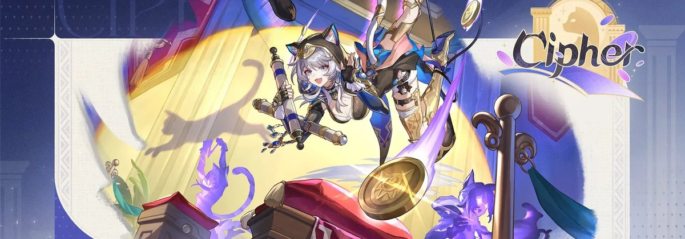

# NasusBeatbox

Gestionnaire de comptes League of Legends pour Windows. Ce dépôt ne contient que
les versions téléchargeables — le code source est privé.

Il sert aussi de source à la mise à jour automatique de l'application, ce qui est
la raison pour laquelle il est public : l'app peut lire ce flux sans aucun jeton,
et n'a donc aucun secret à transporter.

## Installer

1. Va dans **[Releases](../../releases/latest)** et télécharge `NasusBeatboxInstaller.exe`.
2. Double-clique. Rien d'autre à faire, aucun dossier à choisir.

Windows affichera « Windows a protégé votre ordinateur » au premier lancement :
l'exe n'est pas signé, un certificat étant payant. Clique sur **Informations
complémentaires**, puis **Exécuter quand même**. Une seule fois.

## Au premier démarrage

L'application demande comment tu veux t'en servir :

- **À plusieurs** — colle le code de partage que t'a donné la personne qui l'a
  déjà installée, et c'est fini.
- **Tout seul** — pas encore disponible, prévu pour la v0.3.

## Mises à jour

L'application vérifie seule les nouvelles versions, les télécharge en fond, et
propose de redémarrer pour les poser. Rien à refaire à la main.

## Crédits

Illustration : art officiel de Cipher, Honkai: Star Rail, propriété de HoYoverse.
Projet non affilié à HoYoverse ni à Riot Games.
